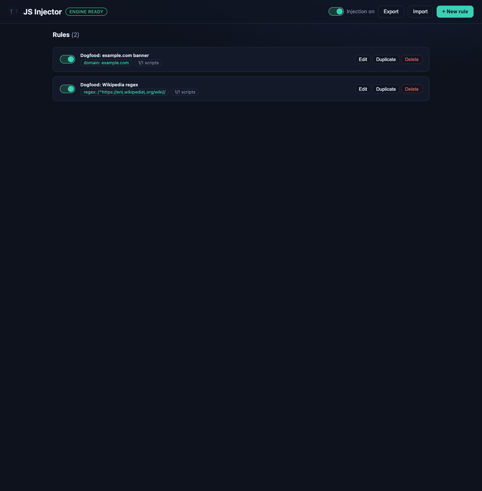
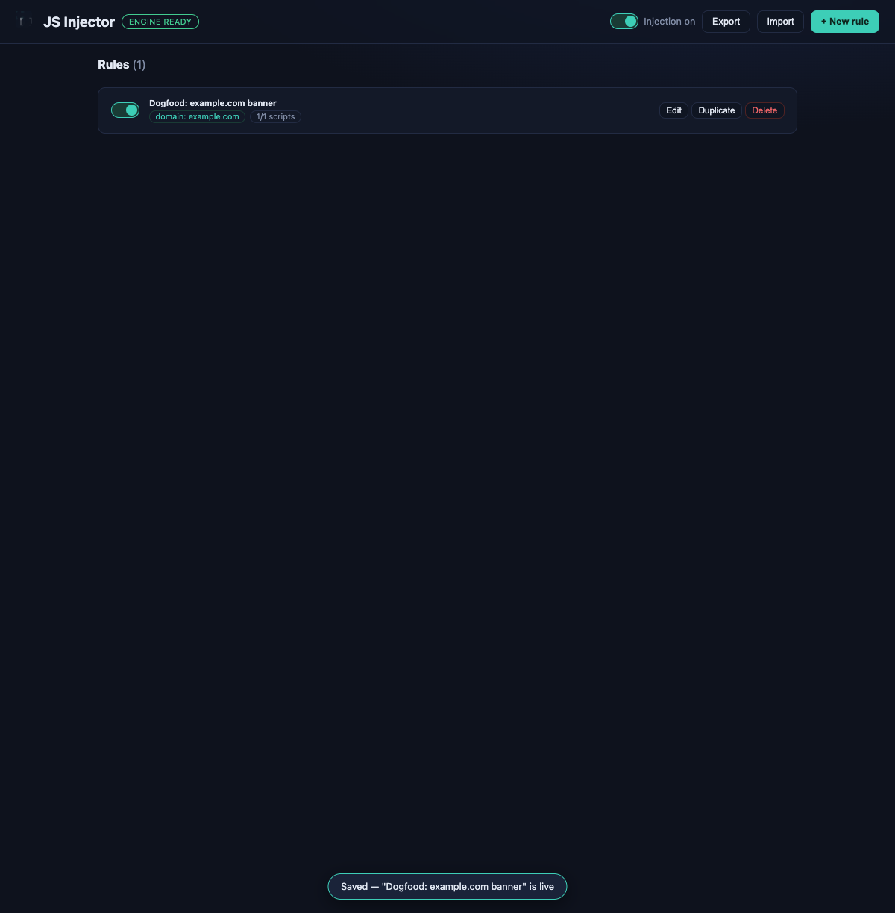
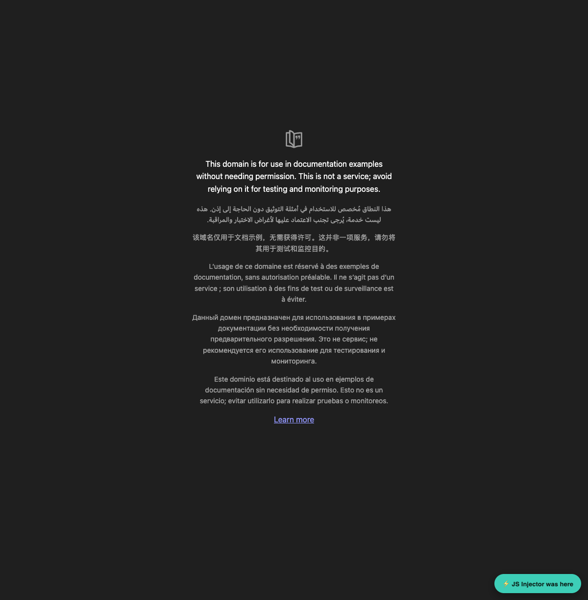
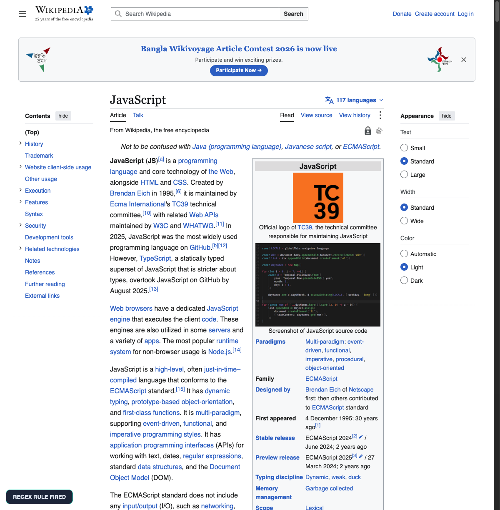
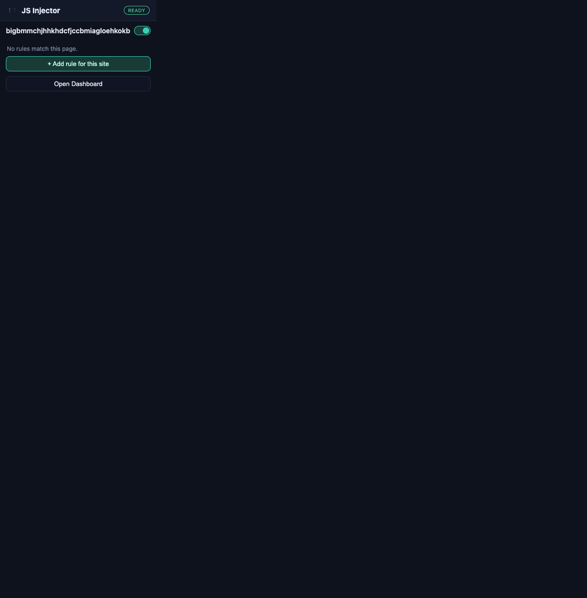

# JS Injector

A Chrome extension (Manifest V3) for injecting arbitrary JavaScript into websites, managed from a full dashboard. Rules can match by **base domain**, **regex on the full URL**, or **Chrome match patterns** — and each rule can carry **multiple scripts**, each with its own timing (`document_start` / `document_end` / `document_idle`) and execution world (page `MAIN` or isolated).



## Features

- **Dashboard** (options page): create/edit/duplicate/delete rules, edit code per script, reorder scripts, live regex/match tester (paste URLs → instant ✔/✘), JSON import/export, global kill switch.
- **Popup**: per-site rule toggles for the current tab, global toggle, one-click "add rule for this site".
- **Match types**
  - `domain` — `example.com` matches `example.com` and all subdomains, any port/scheme.
  - `regex` — JavaScript regex tested against `location.href`.
  - `pattern` — raw Chrome match patterns, one per line (advanced).
- **Multiple scripts per site** — several rules and several scripts per rule; scripts execute in list order.
- **Runs everywhere** — injected via the [`chrome.userScripts`](https://developer.chrome.com/docs/extensions/reference/api/userScripts) API, so scripts run in the page's `MAIN` world and are **exempt from page CSP** (works on github.com, twitter.com, etc.).
- **Local only** — rules and code live in `chrome.storage.local`; nothing leaves the browser.

## Install (unpacked)

1. Open `chrome://extensions`.
2. Enable **Developer mode** (top right).
3. Click **Load unpacked** and select this directory.
4. Open the extension's **Details** page and turn on **Allow user scripts** (Chrome 135+; required for the injection engine).
5. Click the toolbar icon → **Open Dashboard** (or use the puzzle-piece menu to pin it).

> The dashboard shows an "engine off" banner with these instructions whenever the userScripts engine isn't enabled yet.

## Usage

Create a rule, pick a match type, add one or more scripts, save — scripts are registered immediately and run on the next matching page load.

```js
// Example script: runs in the page (MAIN world) at document_idle
document.body.insertAdjacentHTML('beforeend',
  '<div style="position:fixed;bottom:14px;right:14px;z-index:9999">⚡ injected</div>');
```

Notes:
- Code is wrapped in an IIFE; top-level `function`/`var` declarations stay local — assign to `window` explicitly to expose globals.
- Errors in your code are logged to the page console as `[JS Injector] <rule>/<script>: …`.
- `USER_SCRIPT` world scripts share the DOM but not the page's JS context (and can use `chrome.runtime` messaging).

## Development

```bash
npm install
npm run test          # unit tests (vitest, 82 tests)
npm run test:e2e      # end-to-end on real Chromium (Playwright, 13 tests)
npm run icons         # regenerate icon PNGs (no deps)
```

E2E notes:
- Uses Playwright's Chromium with `--load-extension`. If no browser matches, run `npx playwright install chromium`.
- The first spec enables the per-extension **Allow user scripts** toggle automatically via `chrome://extensions` UI automation.
- Set `E2E_HEADLESS=1` to try headless mode (extensions generally need headed Chromium).

## Architecture

```
manifest.json          MV3: storage, userScripts, scripting, activeTab; <all_urls>
background.js          service worker — syncs registrations, answers probe/sync messages
lib/
  match.js             rule → userScript defs (patterns, regex guard wrapper, URL matching)
  store.js             storage schema, validation, import/export
  sync.js              registration engine: availability probe + diff-based idempotent sync;
                       adapts both userScripts API flavors (Chrome 120–134 and 135+)
dashboard/             options page UI (rules CRUD, editor, tester, import/export)
popup/                 toolbar popup
tools/generate-icons.mjs  dependency-free PNG icon generator
tests/unit/            vitest suites + in-memory chrome mock (both API flavors)
tests/e2e/             Playwright specs, fixtures (extension loader, local HTTP server,
                       CSP-strict page, document_start page), chrome://extensions automation
```

Key design points:
- The `userScripts` API only binds in the **service worker** on current Chrome — the dashboard/popup ask it via `jsi:probe` / `jsi:sync` messages.
- Regex rules register on `<all_urls>` with a generated guard (`if (new RegExp(...).test(location.href)) { … }`) — still CSP-exempt, no `eval`.
- Syncs are diff-based and idempotent: only changed/removed scripts are re-registered; a failing diff never double-registers the same id.

## Screenshots

| | |
|---|---|
|  |  |
| Dashboard with a rule | Injected banner on example.com |
|  |  |
| Regex rule on Wikipedia | Popup |

## Security

This tool executes **arbitrary JavaScript** with page-level privileges. Only add scripts you understand. Imported JSON is validated, but it is still code — treat rule files like you'd treat scripts. All data stays local to your browser profile.
